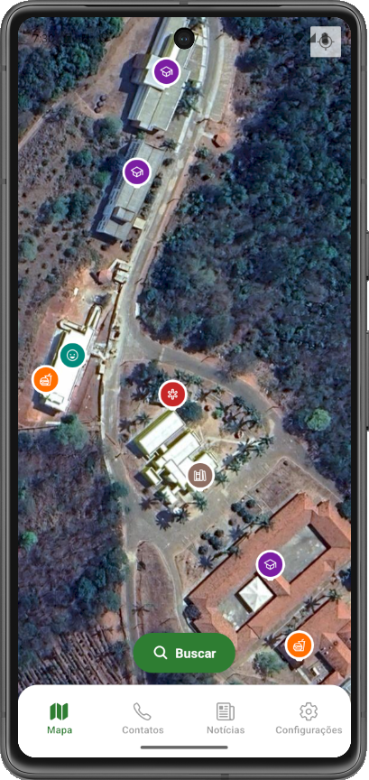
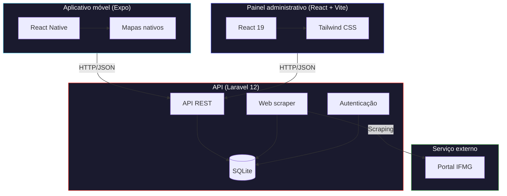

<div align="center">

```
██╗███████╗███╗   ███╗ █████╗ ██████╗ 
██║██╔════╝████╗ ████║██╔══██╗██╔══██╗
██║█████╗  ██╔████╔██║███████║██████╔╝
██║██╔══╝  ██║╚██╔╝██║██╔══██║██╔═══╝ 
██║██║     ██║ ╚═╝ ██║██║  ██║██║     
╚═╝╚═╝     ╚═╝     ╚═╝╚═╝  ╚═╝╚═╝     
```

Sistema de orientação espacial para o campus do Instituto Federal de Minas
Gerais (IFMG), Minas Gerais, Brasil.

[](LICENSE)
[](https://laravel.com)
[](https://react.dev)
[](https://expo.dev)
[](https://www.typescriptlang.org)

</div>

---

## Sobre o projeto

O IFMap resolve um problema concreto de orientação espacial no campus do IFMG.
Ele reúne, em um aplicativo móvel e em um painel administrativo web, as
informações que hoje estão dispersas ou disponíveis apenas presencialmente: a
localização dos prédios e áreas do campus, os setores que funcionam em cada um
deles, os serviços prestados, os contatos telefônicos institucionais e as
notícias publicadas no portal do instituto.

O público-alvo são estudantes ingressantes, servidores e visitantes, que
frequentemente precisam localizar um setor específico ou identificar onde um
determinado serviço é prestado.

O sistema é composto por três módulos independentes que se comunicam por uma API
REST: o aplicativo móvel (consumo público), o painel administrativo (manutenção
do conteúdo) e o backend (regras de negócio e persistência).

### Objetivos

- Disponibilizar a localização georreferenciada dos prédios, setores e áreas do campus.
- Centralizar a lista telefônica institucional em uma interface de consulta rápida.
- Permitir que servidores mantenham o conteúdo atualizado sem intervenção técnica.
- Agregar as notícias do portal institucional em um único feed.

---

## Capturas de tela

<div align="center">
<table>
  <tr>
    <td align="center"><strong>Mapa do campus</strong></td>
    <td align="center"><strong>Notícias</strong></td>
    <td align="center"><strong>Configurações</strong></td>
  </tr>
  <tr>
    <td></td>
    <td></td>
    <td></td>
  </tr>
</table>
</div>

---

## Funcionalidades

| Funcionalidade | Descrição |
|---|---|
| Mapa interativo | Visualização dos prédios e áreas do campus com marcadores e navegação |
| Detalhes dos prédios | Setores instalados, serviços prestados e fotos de cada local |
| Lista telefônica | Diretório de contatos com busca por nome ou setor |
| Feed de notícias | Notícias obtidas do portal institucional por meio de web scraping |
| Painel administrativo | CRUD completo de locais, setores, serviços, contatos, fotos e notícias |
| Aplicativo móvel | Aplicação nativa com mapas integrados para Android e iOS |
| Busca | Localização de prédios, setores e serviços a partir de um termo |
| Galeria de fotos | Registro fotográfico dos prédios e ambientes do campus |

---

## Tecnologias

<div align="center">

**Backend**

[](https://php.net)
[](https://laravel.com)
[](https://sqlite.org)
[](https://getcomposer.org)

**Painel administrativo**

[](https://react.dev)
[](https://vitejs.dev)
[](https://typescriptlang.org)
[](https://tailwindcss.com)

**Aplicativo móvel**

[](https://expo.dev)
[](https://reactnative.dev)
[](https://github.com/react-native-maps/react-native-maps)

</div>

---

## Arquitetura



Descrição detalhada dos módulos, do fluxo de dados e das decisões de projeto em
[`docs/architecture.md`](docs/architecture.md).

---

## Estrutura do repositório

```
ifmap/
├── backend/                     API Laravel 12
│   ├── app/
│   │   ├── Http/Controllers/    Controllers da API
│   │   ├── Http/Requests/       Validação de requisições
│   │   └── Models/              Modelos Eloquent
│   ├── database/
│   │   ├── factories/           Factories para testes
│   │   ├── migrations/          Migrações do banco
│   │   └── seeders/             Dados iniciais do campus
│   ├── routes/
│   │   └── api.php              Rotas da API REST
│   ├── tests/                   Testes automatizados (PHPUnit)
│   │   ├── Feature/
│   │   └── Unit/
│   ├── phpunit.xml
│   └── .env.example
│
├── frontend/                    Painel administrativo (React + Vite)
│   ├── src/
│   │   ├── components/          Componentes (CRUDs, dashboard, layout)
│   │   ├── contexts/            Contextos e providers (autenticação, avisos)
│   │   ├── hooks/               Hooks de consumo dos contextos
│   │   ├── services/            Integração com a API (Axios)
│   │   └── types/               Tipagens TypeScript
│   ├── .env.example
│   └── vite.config.ts
│
├── mobile/                      Aplicativo móvel (Expo)
│   ├── screens/                 Telas do aplicativo
│   ├── components/              Componentes compartilhados
│   ├── services/                Integração com a API
│   ├── config/                  Configuração de ambiente e da API
│   ├── context/                 Tema e acessibilidade
│   ├── hooks/                   Hooks personalizados
│   └── app.json
│
├── docs/                        Documentação técnica
│   ├── README.md                Índice da documentação
│   ├── api.md                   Referência da API
│   ├── architecture.md          Arquitetura do sistema
│   └── screenshots/             Imagens usadas neste README
│
├── .github/                     Integração contínua, templates e Dependabot
│
├── docker-compose.yml
├── Makefile
├── README.md
├── CONTRIBUTING.md
├── CODE_OF_CONDUCT.md
├── SECURITY.md
├── CHANGELOG.md
└── LICENSE
```

---

## Execução do projeto

### Requisitos

| Ferramenta | Versão mínima |
|------------|---------------|
| PHP | 8.2 |
| Composer | 2.x |
| Node.js | 20.x |
| npm | 10.x |
| Expo CLI | executada via `npx` |

### Configuração automatizada (recomendada)

```bash
make setup   # instala dependências e configura o backend
make dev     # executa os três módulos em paralelo
make help    # lista todos os alvos disponíveis
```

### Backend (Laravel)

```bash
cd backend

composer install

cp .env.example .env
php artisan key:generate

php artisan migrate --seed     # cria o banco SQLite e popula os dados iniciais
php artisan storage:link       # expõe as fotos armazenadas

php artisan serve
```

API disponível em `http://localhost:8000/api`.

### Painel administrativo

```bash
cd frontend

npm install
cp .env.example .env

npm run dev
```

Painel disponível em `http://localhost:5173`.

### Aplicativo móvel

```bash
cd mobile

npm install

# Informe a chave do Google Maps e o IP da máquina que executa o backend
# em config/env.config.ts (e a mesma chave em app.json)

npx expo start
```

Leia o QR code exibido no terminal com o aplicativo Expo Go.

### Execução com Docker

```bash
docker-compose up -d    # backend e painel administrativo
docker-compose ps
```

---

## Endpoints da API

### Locais

| Método | Endpoint | Descrição |
|--------|----------|-----------|
| `GET` | `/api/locations` | Lista os locais |
| `GET` | `/api/locations/{id}` | Detalha um local |
| `POST` | `/api/locations` | Cria um local |
| `PUT` | `/api/locations/{id}` | Atualiza um local |
| `DELETE` | `/api/locations/{id}` | Remove um local |

### Setores

| Método | Endpoint | Descrição |
|--------|----------|-----------|
| `GET` | `/api/sectors` | Lista os setores |
| `GET` | `/api/locations/{id}/sectors` | Lista os setores de um local |
| `POST` | `/api/sectors` | Cria um setor |
| `PUT` | `/api/sectors/{id}` | Atualiza um setor |
| `DELETE` | `/api/sectors/{id}` | Remove um setor |

### Serviços

| Método | Endpoint | Descrição |
|--------|----------|-----------|
| `GET` | `/api/services` | Lista os serviços |
| `GET` | `/api/sectors/{id}/services` | Lista os serviços de um setor |
| `POST` | `/api/services` | Cria um serviço |
| `PUT` | `/api/services/{id}` | Atualiza um serviço |
| `DELETE` | `/api/services/{id}` | Remove um serviço |

### Telefones

| Método | Endpoint | Descrição |
|--------|----------|-----------|
| `GET` | `/api/phones` | Lista os telefones |
| `GET` | `/api/locations/{id}/phones` | Lista os telefones de um local |
| `POST` | `/api/phones` | Cria um telefone |
| `PUT` | `/api/phones/{id}` | Atualiza um telefone |
| `DELETE` | `/api/phones/{id}` | Remove um telefone |

### Fotos

| Método | Endpoint | Descrição |
|--------|----------|-----------|
| `GET` | `/api/photos` | Lista as fotos |
| `POST` | `/api/photos` | Envia uma foto (multipart/form-data) |
| `DELETE` | `/api/photos/{id}` | Remove uma foto |

### Notícias

| Método | Endpoint | Descrição |
|--------|----------|-----------|
| `GET` | `/api/news` | Lista as notícias |
| `GET` | `/api/news/{id}` | Detalha uma notícia |
| `POST` | `/api/news` | Cria uma notícia |
| `PUT` | `/api/news/{id}` | Atualiza uma notícia |
| `DELETE` | `/api/news/{id}` | Remove uma notícia |
| `POST` | `/api/news/scrape` | Sincroniza as notícias do portal institucional |

### Autenticação

| Método | Endpoint | Descrição |
|--------|----------|-----------|
| `POST` | `/api/login` | Autentica o usuário e devolve um token |
| `POST` | `/api/logout` | Encerra a sessão |
| `GET` | `/api/me` | Retorna os dados do usuário autenticado |

Referência completa, com exemplos de requisição e resposta, em
[`docs/api.md`](docs/api.md).

> **Aviso.** A autenticação atual é uma implementação simplificada, adequada ao
> ambiente de desenvolvimento: o token não é assinado nem possui prazo de
> validade, e os endpoints de escrita ainda não exigem autenticação. A migração
> para Laravel Sanctum está prevista. Consulte as
> [limitações conhecidas](docs/api.md#limitações-conhecidas) antes de disponibilizar
> a API em uma rede pública.

---

## Testes e qualidade de código

```bash
# Backend: PHPUnit e Laravel Pint
cd backend && composer test
cd backend && composer lint       # composer lint:fix aplica as correções

# Painel administrativo: ESLint, TypeScript e build
cd frontend && npm run lint
cd frontend && npm run typecheck

# Aplicativo móvel: TypeScript
cd mobile && npm run typecheck
```

Pelo Makefile:

```bash
make lint         # análise estática do backend e do painel
make typecheck    # verificação de tipos do painel e do aplicativo
make test         # testes automatizados do backend
```

As mesmas verificações são executadas a cada push e pull request para `main`
pelo [GitHub Actions](.github/workflows/ci.yml).

---

## Contribuição

Contribuições são bem-vindas. O fluxo de trabalho, o padrão de mensagens de
commit e o checklist de revisão estão descritos em
[CONTRIBUTING.md](CONTRIBUTING.md).

1. Faça um fork do repositório.
2. Crie uma branch para a alteração (`git checkout -b feat/nome-da-alteracao`).
3. Registre as mudanças em commits objetivos (`git commit -m "feat: descrição"`).
4. Envie a branch (`git push -u origin feat/nome-da-alteracao`).
5. Abra um pull request descrevendo a motivação e os testes realizados.

Ao participar do projeto, você concorda com o
[Código de Conduta](CODE_OF_CONDUCT.md).

---

## Licença

Distribuído sob a Licença MIT. O texto completo está em [LICENSE](LICENSE).

```
MIT License — Copyright (c) 2024-2026 IFMap Contributors
```

---

## Contexto

Sistema desenvolvido para o campus do **Instituto Federal de Minas Gerais
(IFMG)**, Minas Gerais, Brasil, com o objetivo de facilitar a orientação
espacial de estudantes, servidores e visitantes.

<div align="center">

[Voltar ao início](#sobre-o-projeto)

</div>
